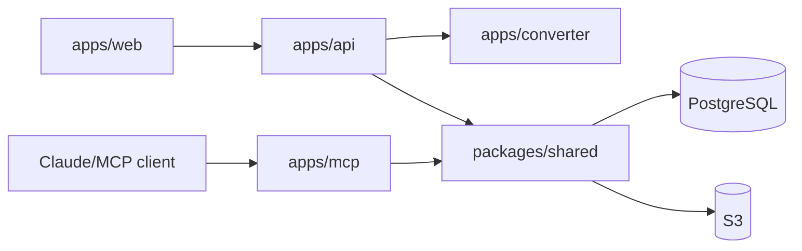

# 核心模組拆解與目錄映射

[← 返回索引](../architecture.md)

程式碼依「職責」拆為 6 個邏輯模組，而非單純的資料夾清單。每個模組對應一份深度解析文件。

| # | 邏輯模組 | 目錄路徑 | 職責 |
|---|---|---|---|
| 1 | **共用基礎設施** | [`packages/shared/src/`](modules/shared.md) | 設定載入、DB 連線池 + RLS、JWT 驗證、S3 客戶端、文字分塊、citation/wikilink 解析、`PostgresVaultFS` 資料存取層。所有 app 都依賴這裡，反向依賴禁止。 |
| 2 | **MCP 伺服器** | [`apps/mcp/src/`](modules/mcp-server.md) | Claude 的唯一入口。10 個 MCP 工具（guide/list/search/read/create/edit/append/delete/lint/create_knowledge_base），stateless HTTP transport，Supabase JWT 驗證。 |
| 3 | **REST + WebSocket API** | [`apps/api/src/`](modules/api-server.md) | Web 前端的資料介面：knowledge-bases/documents/graph CRUD、TUS 續傳上傳、非同步解析佇列、pg LISTEN/NOTIFY → WebSocket 即時推播、API key 管理。 |
| 4 | **文件轉換服務** | [`apps/converter/src/`](modules/converter.md) | 無狀態轉換微服務：PDF → opendataloader Java CLI、Office → LibreOffice → PDF → opendataloader，輸出 per-page markdown。含 SSRF 防護。 |
| 5 | **Web 前端** | [`apps/web/src/`](modules/web.md) | Next.js 14 App Router：Supabase Auth 登入、知識庫瀏覽、多檔上傳、Markdown/PDF 檢視、知識圖譜視覺化。 |
| 6 | **資料庫層** | `supabase/migrations/` | PostgreSQL schema：`users`/`knowledge_bases`/`documents`/`document_pages`/`document_chunks`/`document_references`/`api_keys`，PGroonga 全文索引，RLS 政策，`document_changes` NOTIFY trigger。詳見 [workflows.md](workflows.md) 中的 schema 表格。 |

## 依賴方向

- `apps/*` 只依賴 `packages/shared`，**絕不反向**。
- `apps/mcp` 與 `apps/api` 皆透過 `packages/shared` 的 `PostgresVaultFS` 存取資料，
  兩者不互相呼叫；一致性由共用資料層保證。
- `apps/web` 不直連資料庫，只透過 `apps/api` 的 REST/WebSocket 介面。
