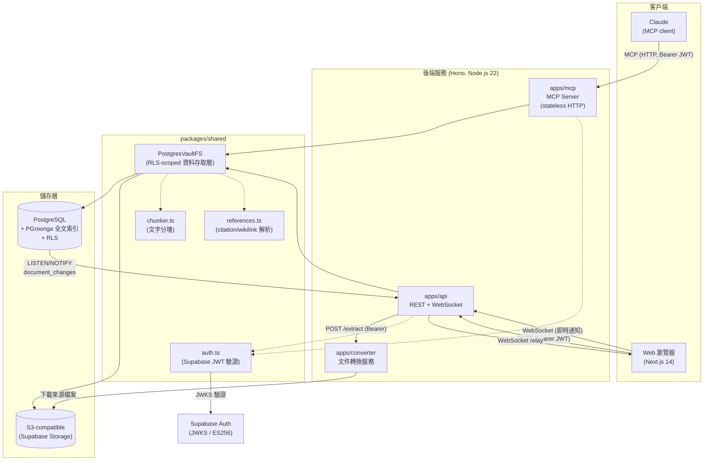

# 系統總覽與全域架構

[← 返回索引](/docs/architecture.md)

## 一句話總結

Team KMS 是一個 **Claude-via-MCP 知識庫 wiki 系統**：後端（`apps/api` / `apps/mcp` /
`apps/converter`）只負責上傳、解析、索引與服務資料，**零 LLM 呼叫**；所有「智慧」——
理解來源、撰寫/編輯 wiki 頁面、建立引註與交叉連結——都由 Claude 透過 MCP 工具直接操作。

## 全域技術架構圖

## 資料流摘要

- **上傳/解析（Ingest）**：Web 上傳檔案 → `apps/api` → S3 → （PDF/Office）`apps/converter`
  轉出 per-page markdown → `apps/api` 分塊（chunker）→ 寫入 `document_chunks`（PGroonga 索引）。
  純文字/Markdown 檔案略過 converter，直接分塊索引。詳見 [workflows.md](/docs/architecture/workflows.md)。
- **合成（Synthesis）**：Claude 透過 MCP `search`/`read` 查閱來源，再用 `create`/`edit`/`append`
  寫 wiki 頁。每次寫入都會解析內文中的 footnote citation 與 wiki link，更新
  `document_references` 圖譜邊，並回報「哪些頁面引用了剛編輯的這頁」。**後端全程零 LLM 呼叫**。
- **即時同步**：Postgres trigger 在 `documents` 表 INSERT/UPDATE/DELETE 時發出
  `NOTIFY document_changes`；`apps/api` 監聽後透過 WebSocket 推送給前端。

## 核心技術棧

| 分類 | 技術 | 說明 |
|---|---|---|
| Runtime | Node.js ≥ 22 (ESM, TypeScript 5.7) | 全 Node 實作，含 converter |
| Monorepo | pnpm workspaces | `packages/shared` + `apps/{mcp,api,converter,web}` |
| 後端框架 | Hono v4.6.14 | 可攜至 Cloudflare Workers |
| MCP 框架 | `@modelcontextprotocol/sdk` v1.29.0 | Web-standard Streamable HTTP transport（stateless） |
| 資料庫 | PostgreSQL + PGroonga 全文索引 | Supabase 託管；`&@~` 全文檢索算子 |
| 認證 | Supabase Auth（ES256 JWT）+ `jose` JWKS 驗證 | RLS 依 `request.jwt.claims` 隔離每位使用者 |
| 物件儲存 | S3-compatible（Supabase Storage）+ `@aws-sdk/client-s3` | 存放原始上傳檔案（PDF/Office 來源） |
| 文件轉換 | `@opendataloader/pdf`（Java CLI 包裝）+ LibreOffice（Office→PDF） | 與 Python 原版同一轉換引擎，零品質損失 |
| 上傳協議 | TUS 1.0（`apps/api/tus.ts`，最大 200MB） | 續傳式上傳，simple multipart 為輔 |
| 前端框架 | Next.js 14（App Router）+ React 18 | Client components，Supabase Auth |
| 前端資料視覺化 | `react-markdown` 9 + `mermaid` 11 + `react-force-graph-2d` 1.25 | Wiki 內容渲染 + 知識圖譜 |
| 測試 | Vitest 2.1.8 | 對本機 Supabase stack 跑整合測試 |

## 部署拓樸

- 根目錄 `Dockerfile`：Node 22-slim，建置 `api` / `mcp` / `web`。
- `apps/converter/Dockerfile`：額外安裝 JRE headless + LibreOffice（writer/impress/calc）。
- `docker-compose.yml`：`converter`(8002) ← `api`(8000) ← `mcp`(8001) / `web`(3000)；
  不內嵌 Postgres，資料庫/Auth/Storage 全由 Supabase 提供。
