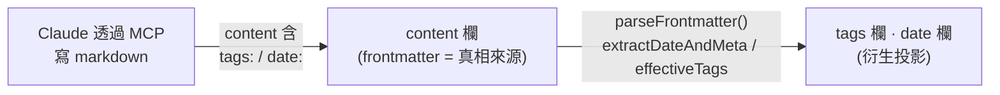
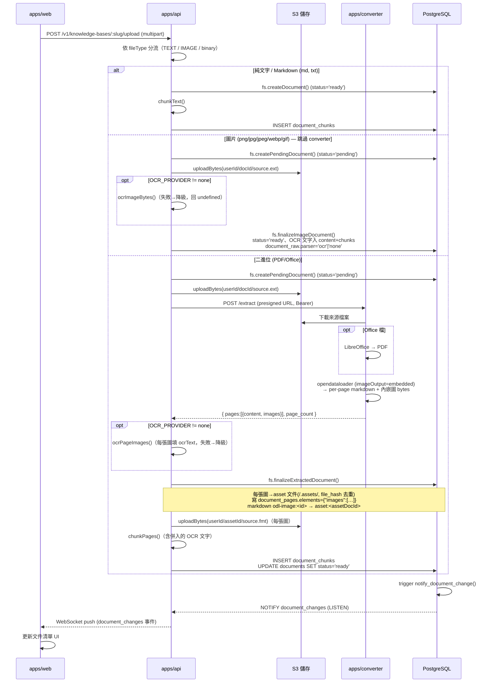
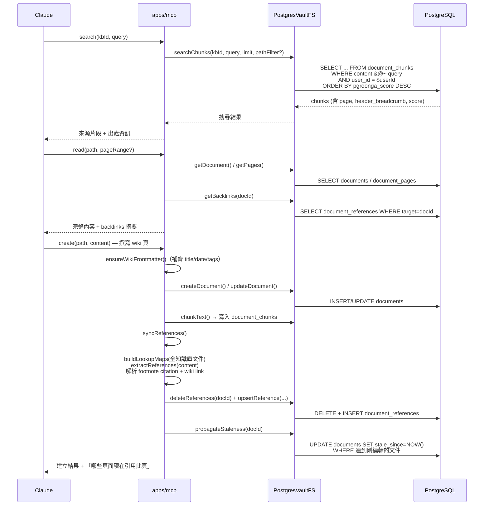

# 核心業務流程與時序圖

[← 返回索引](/docs/architecture.md)

系統有兩個最核心的業務流程：**檔案上傳→解析→索引**，以及 **Claude 透過 MCP 搜尋/讀取/
撰寫**。兩者共用同一組資料表（見下方 schema），互不呼叫，靠共用資料層維持一致性。

## 資料庫 Schema 摘要

Migration 順序（`supabase/migrations/`）：

| 檔案 | 內容 |
|---|---|
| `001_initial.sql` | `users`、`api_keys`、`knowledge_bases`、`documents`、`document_pages`、`document_chunks`；PGroonga 全文索引於 `document_chunks.content` 與 `documents.content`；各表 RLS SELECT 政策（`user_id = auth.uid()`） |
| `002_document_references.sql` | `document_references`（來源→目標邊）；`documents` 新增 `stale_since` 欄位 |
| `003_document_notify.sql` | Trigger `notify_document_change()`：`documents` INSERT/UPDATE/DELETE 時 `NOTIFY document_changes`，payload 含事件類型 + IDs |
| `004_document_references_write_policies.sql` | 已認證使用者可在自己的知識庫內 INSERT/UPDATE/DELETE 引用邊 |
| `008_kb_kind.sql` | `knowledge_bases.kind`（`'wiki'` \| `'course'`，預設 `'wiki'`） |
| `009_documents_unique_active.sql` | 部分唯一索引 `(kb_id, path, filename) WHERE NOT archived`——確保「建立 vs 覆蓋」語意正確，且已歸檔文件不擋新建 |

核心表：

- **`documents`**：`id, kb_id, user_id, filename, title, path, content, file_type,
  kind('raw'|'wiki'|'asset'), status, page_count(≤300), tags[], metadata, date, file_size,
  file_hash, version, stale_since, archived`。`kind` 是文件分類（raw 上傳來源 / wiki Claude 稿 /
  asset 內嵌素材），寫入時明確指派；`file_hash` 為原始 bytes sha256，供同 KB 上傳去重。
- **`document_raw`**：`document_id(PK→documents), parser, error_message`。raw 專屬的處理紀錄/备查欄，
  1:1 掛在 raw 文件下（CTI 子表）；wiki/asset 無此列。`page_count` 因熱路徑留在 base。
- **`sources` / `wiki_pages`**（VIEW）：各投影 `kind='raw'`（join `document_raw`）/ `kind='wiki'`
  的相關欄位，輔助瀏覽；app 資料層仍讀 base。
- **`document_chunks`**：`id, document_id, user_id, kb_id, chunk_index, content(≤10k字元),
  page, start_char, token_count, header_breadcrumb`；PGroonga 索引
  `idx_chunks_content_pgroonga` 支援 `&@~` 全文檢索算子。
- **`document_pages`**：`id, document_id, page, content(≤500k字元), elements(JSONB)`
- **`document_references`**：`id, source_document_id, target_document_id, kb_id,
  reference_type('cites'|'links_to'), page`
- **`api_keys`**：`id, user_id, name, key_hash, key_prefix, created_at, last_used_at, revoked_at`

RLS 策略：所有表皆啟用 RLS；base policy 為 `SELECT` 限定 `user_id = auth.uid()`
（或透過知識庫擁有權間接限定）；寫入操作走 `packages/shared/db.ts` 的 `scopedExecute`
（一般使用者）或 `serviceExecute`（系統內部信任操作，如 pending 文件建立、chunk 索引寫入）。

> 註：上表為**邏輯順序**；實際檔名已改用 Supabase 官方時間戳慣例
> （`YYYYMMDDHHmmss_*.sql`，時間取自各檔建立時間）。另外 `knowledge_bases.kind`
> （wiki/course）與 `documents.url`（Chrome 擴充功能 webclip 用）皆為 upstream 照搬但本
> 專案用不到的欄位，已由後續 drop migration 移除。

---

## `documents` 表設計概念：單一表存兩種東西，frontmatter 是真相來源

`documents` 是整個系統的核心，有兩個容易誤解的設計要點：

### ① 同一張表同時裝「來源檔」與「wiki 頁」

靠 `path` 區分，這是 VaultFS「所有東西都是 document」的抽象：

- `path` 以 `/wiki/` 開頭 → **Claude 撰寫的 wiki 頁**（overview / concepts / entities…）
- 其他 path → **使用者上傳的來源檔**（PDF / docx / md / 圖片…）

所以很多欄位只對其中一種有意義，另一種留 NULL/預設，屬正常設計。

### ② 資料流方向：frontmatter → 欄位（不是反過來）

對 wiki 頁而言，**`content`（含 YAML frontmatter 的 markdown）才是唯一真相來源**；
`tags`、`date` 這兩個欄位是**從 frontmatter 抽出來的「衍生投影」（denormalized copy）**，
目的是讓 SQL 能直接查詢/排序，不必每次去 parse markdown。**不是資料庫欄位餵給
frontmatter，而是 frontmatter 餵給資料庫欄位。**

實作位置：`apps/mcp/src/wiki.ts`（`parseFrontmatter` / `extractDateAndMeta` /
`effectiveTags`）→ `packages/shared/src/vaultfs.ts` 的 `createDocument` / `updateDocument`
把抽出的 `tags`、`date` 寫進欄位。修正既有 `date` 欄位時也是**以 content frontmatter 為準**回填。

> 踩雷提醒：YAML 1.1 有內建 timestamp 型別，無引號的 `date: 2026-06-30` 會被 js-yaml
> 解析成 JavaScript `Date` 物件，若直接 `String()` 會變成
> `Tue Jun 30 2026 08:00:00 GMT+0800 (...)` 這種長格式。`extractDateAndMeta` 已特判
> `Date` 物件、正規化回 `YYYY-MM-DD`。

### ③ 欄位角色速查

| 角色 | 欄位 | 說明 |
|---|---|---|
| 分類 | `kind`（`raw`/`wiki`/`asset`） | 寫入時明確指派；取代舊的 `metadata->>'asset'` flag |
| 核心 | `filename` `title` `path` `file_type` `status` `content` `page_count` `version` `archived` | 兩種文件都用 |
| 衍生投影（來自 frontmatter） | `tags` `date` | wiki 頁才有值；真相在 `content` frontmatter |
| ingest 寫入 | `file_size`（byte 數）、`file_hash`（原始 bytes sha256，去重用） | 上傳時填 |
| raw 處理紀錄（子表 `document_raw`） | `parser`（`text`/`opendataloader`/`ocr`/`none`）、`error_message` | 移出 base；1:1 掛 raw/asset 文件 |
| 圖譜/維護 | `document_number`（每 KB 遞增，trigger 自動）、`stale_since`（引用來源被編輯時標記） | 自動維護 |
| 已移除 | ~~`url`~~、~~`kind`(舊 course 版)~~、`sort_order`（upstream 後端也沒用） | 見上方 migration 註 |

---

## 流程一：檔案上傳 → 解析 → 索引

**文字說明**：使用者在 `/wikis/:slug` 選擇檔案上傳，`apps/api`（`ingest.ts`）依 `fileType` 分三支：

- **純文字 / Markdown**（`md`/`txt`）：直接分塊寫入索引，**不進 Storage**。
- **圖片**（`png`/`jpg`/`jpeg`/`webp`/`gif`）：**跳過 converter**——建 `pending` 文件、上傳原始圖到
  Storage，（可選）對圖跑 OCR 抽文字，`finalizeImageDocument()` 收斂 `ready`（有 OCR 文字則入
  `content` + chunks，`document_raw.parser` 記 `ocr`／否則 `none`）。修好了原本圖片被當 binary
  丟給 converter → 400 → 卡 pending 的壞路徑。
- **PDF / Office 二進位**：建 `pending`、上傳 Storage、呼叫 `apps/converter` 轉出逐頁 markdown
  **+ 內嵌圖 bytes**（`imageOutput: "embedded"`）；`finalizeExtractedDocument()` 把每張圖存成
  `kind='asset'` 子文件（Storage key `/.assets/`、metadata `{hidden, parent_document_id, kind:'pdf_image'}`、
  `file_hash` 去重）、寫 `document_pages.elements = {"images":[…]}`、把 page markdown 的
  `odl-image:<id>` 改寫成 `asset:<assetDocId>`；（可選）對圖跑 OCR，文字併入該頁 chunk。

OCR 為**可選**（`OCR_PROVIDER` 未設則 `none`，維持後端零 LLM）、**失敗優雅降級**（圖仍存、文件仍
`ready`，只缺 OCR 文字）。索引完成後 trigger 發 NOTIFY → `apps/api` relay 給前端 WebSocket，
前端即時更新文件清單，無需輪詢。

---

## 流程二：Claude 透過 MCP 搜尋 / 讀取 / 撰寫

**文字說明**：Claude 先用 `search` 工具以 PGroonga 全文檢索找到相關來源片段（含頁碼、
標題階層麵包屑），再用 `read` 讀取完整內容（分頁來源支援 page range，並附上該文件的
backlinks 摘要）。撰寫時呼叫 `create`/`edit`/`append`，工具會先確保 frontmatter 完整，
寫入 `documents` 表後觸發 `syncReferences()`：解析內文中的 footnote citation 與 wiki
link，比對所有文件的檔名/路徑索引，重建 `document_references` 圖譜邊，並將連到被編輯
文件的其他頁面標記為 `stale_since`（過期提示）。全程後端**零 LLM 呼叫**。

