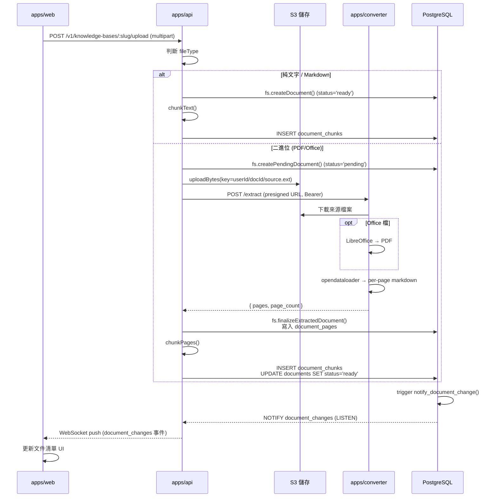
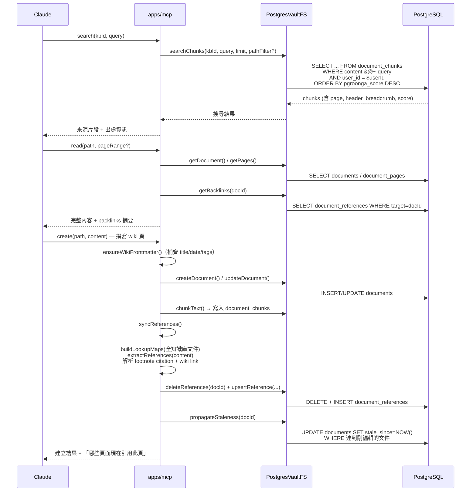

# 核心業務流程與時序圖

[← 返回索引](../architecture.md)

系統有兩個最核心的業務流程：**檔案上傳→解析→索引**，以及 **Claude 透過 MCP 搜尋/讀取/
撰寫**。兩者共用同一組資料表（見下方 schema），互不呼叫，靠共用資料層維持一致性。

## 資料庫 Schema 摘要

Migration 順序（`supabase/migrations/`）：

| 檔案 | 內容 |
|---|---|
| `001_initial.sql` | `users`、`api_keys`、`knowledge_bases`、`documents`、`document_pages`、`document_chunks`；PGroonga 全文索引於 `document_chunks.content` 與 `documents.content`；各表 RLS SELECT 政策（`user_id = auth.uid()`） |
| `002_document_references.sql` | `document_references`（來源→目標邊）；`documents` 新增 `stale_since` 欄位 |
| `003_document_notify.sql` | Trigger `notify_document_change()`：`documents` INSERT/UPDATE/DELETE 時 `NOTIFY document_changes`，payload 含事件類型 + IDs |
| `004_document_references_write_policies.sql` | 已認證使用者可在自己的知識庫內 INSERT/UPDATE/DELETE 引用邊 |
| `008_kb_kind.sql` | `knowledge_bases.kind`（`'wiki'` \| `'course'`，預設 `'wiki'`） |
| `009_documents_unique_active.sql` | 部分唯一索引 `(kb_id, path, filename) WHERE NOT archived`——確保「建立 vs 覆蓋」語意正確，且已歸檔文件不擋新建 |

核心表：

- **`documents`**：`id, kb_id, user_id, filename, title, path, content, file_type, status,
  page_count(≤300), tags[], metadata, date, version, stale_since, archived`
- **`document_chunks`**：`id, document_id, user_id, kb_id, chunk_index, content(≤10k字元),
  page, start_char, token_count, header_breadcrumb`；PGroonga 索引
  `idx_chunks_content_pgroonga` 支援 `&@~` 全文檢索算子。
- **`document_pages`**：`id, document_id, page, content(≤500k字元), elements(JSONB)`
- **`document_references`**：`id, source_document_id, target_document_id, kb_id,
  reference_type('cites'|'links_to'), page`
- **`api_keys`**：`id, user_id, name, key_hash, key_prefix, created_at, last_used_at, revoked_at`

RLS 策略：所有表皆啟用 RLS；base policy 為 `SELECT` 限定 `user_id = auth.uid()`
（或透過知識庫擁有權間接限定）；寫入操作走 `packages/shared/db.ts` 的 `scopedExecute`
（一般使用者）或 `serviceExecute`（系統內部信任操作，如 pending 文件建立、chunk 索引寫入）。

---

## 流程一：檔案上傳 → 解析 → 索引

**文字說明**：使用者在 `/wikis/:slug` 選擇檔案上傳。若是純文字/Markdown，`apps/api`
直接分塊寫入索引；若是 PDF/Office 等二進位檔，先建立 `pending` 狀態文件、上傳原始檔到
S3，再呼叫 `apps/converter` 轉出逐頁 markdown，回寫後分塊索引並將狀態改為 `ready`。
索引完成後，資料庫 trigger 發出 NOTIFY，`apps/api` relay 給前端 WebSocket，前端即時更新
文件清單，無需輪詢。

---

## 流程二：Claude 透過 MCP 搜尋 / 讀取 / 撰寫

**文字說明**：Claude 先用 `search` 工具以 PGroonga 全文檢索找到相關來源片段（含頁碼、
標題階層麵包屑），再用 `read` 讀取完整內容（分頁來源支援 page range，並附上該文件的
backlinks 摘要）。撰寫時呼叫 `create`/`edit`/`append`，工具會先確保 frontmatter 完整，
寫入 `documents` 表後觸發 `syncReferences()`：解析內文中的 footnote citation 與 wiki
link，比對所有文件的檔名/路徑索引，重建 `document_references` 圖譜邊，並將連到被編輯
文件的其他頁面標記為 `stale_since`（過期提示）。全程後端**零 LLM 呼叫**。

